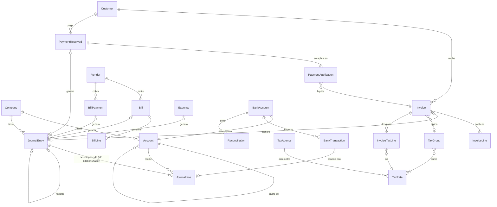

# Chirogra — Documento de diseño

> Estado: **borrador para revisión** (v0.3, 31 oct 2026).
> Nada de este documento está implementado todavía. Las secciones marcadas con 🔶 son decisiones abiertas; las marcadas con ✅ ya las confirmó el usuario.
>
> **Alcance de este documento:** solo la parte técnica (alcance, módulos, modelo de datos, arquitectura, persistencia, sincronización y riesgos). El diseño visual, las pantallas y la navegación se definen en **Claude Design** (ver §7).
>
> **Decisiones confirmadas (v0.2):** ✅ iPhone + iPad + Mac con SwiftUI multiplataforma · ✅ Estados Unidos, USD, *sales tax* (no IVA) · ✅ un solo usuario por empresa · ✅ sincronización privada con iCloud entre los dispositivos del usuario.

---

## 1. Visión

**Chirogra** es una app de contabilidad para pequeños negocios (autónomos, comercios, despachos y empresas de servicios de 1 a 20 personas) que quieren llevar sus libros con rigor contable —doble partida real— sin necesitar formación de contador para el día a día.

Principios de producto:

1. **Rigor por debajo, sencillez por encima.** Cada factura, pago o gasto genera automáticamente su asiento de doble partida. El usuario trabaja con documentos de negocio; el libro diario se mantiene solo.
2. **Nada se borra, todo se corrige.** Un asiento contabilizado es inmutable. Las correcciones se hacen con asientos de reversión o anulaciones con rastro de auditoría.
3. **Nativa de Apple.** SwiftUI en iPhone, iPad y Mac, con atajos de teclado, arrastrar y soltar recibos, Face ID y modo oscuro desde el primer día.
4. **Datos del usuario, en dispositivos del usuario.** Funciona sin conexión; la sincronización en la nube es opcional y privada.
5. **Identidad propia.** Nombre, marca, diseño visual (definido en Claude Design), iconografía y textos son originales de Chirogra. No se reutilizan la interfaz, los logos, la terminología de marca ni los flujos distintivos de ningún producto competidor (QuickBooks, Xero, Holded, etc.). Los términos contables genéricos (factura, asiento, balance) son de uso común y sí se usan.

---

## 2. Plataformas objetivo

| Plataforma | Uso previsto |
|---|---|
| **macOS** | Puesto principal de trabajo: captura masiva, conciliación, reportes |
| **iPadOS** | Igual que Mac, con pantalla táctil |
| **iOS (iPhone)** | Consulta rápida, facturar en movimiento, fotografiar recibos |

- **Un solo código SwiftUI multiplataforma** (un target de app multiplataforma en Xcode). La estructura de navegación de cada plataforma sale del diseño de Claude Design (§7).
- ✅ **Las tres plataformas en el MVP.** Versión mínima propuesta: iOS 26 / iPadOS 26 / macOS 26.
  - Motivo: SwiftData es notablemente más estable y completo a partir de la generación 26 (herencia de modelos, mejoras en predicados e historial). Con Xcode 27 se compila contra el SDK 27; soportar una versión hacia atrás cubre la gran mayoría de dispositivos activos.
  - Alternativa: iOS 18 / macOS 15 para más alcance, a cambio de evitar algunas APIs de SwiftData.
- **Fuera de alcance:** Android, web, Windows. Si en el futuro se necesitan, la capa de dominio (Swift puro, sin dependencias de Apple) es portable y la sincronización tendría que pasar a un backend propio (ver §6.5).

---

## 3. Alcance: MVP frente a fases posteriores

### 3.1 MVP (v1.0) — "libros completos de una empresa, en un dispositivo o en los dispositivos del mismo usuario"

| Módulo | Incluido en MVP |
|---|---|
| Alta de empresa | Asistente inicial: nombre legal y comercial, EIN (opcional), estado, tipo de entidad (sole proprietorship, LLC, S corp, C corp, partnership), moneda USD, inicio del año fiscal, plantilla de plan de cuentas |
| Plan de cuentas | Árbol jerárquico, 5 tipos (Activo, Pasivo, Patrimonio, Ingreso, Gasto), códigos, activar/archivar, saldos |
| Asientos de diario | Asientos manuales multilínea, validación débito = crédito, borrador → contabilizado → revertido |
| Libro mayor | Movimientos por cuenta con saldo acumulado y filtro por fechas |
| Clientes y facturas de venta | Ficha de cliente, facturas con líneas, impuestos, numeración correlativa, cobros (totales y parciales), notas de crédito |
| Proveedores y facturas por pagar | Ficha de proveedor, facturas recibidas, pagos (totales y parciales) |
| Gastos / recibos | Gasto pagado al momento (efectivo, banco, tarjeta) con foto/PDF del recibo adjunto |
| Impuesto sobre ventas (*sales tax*) | Tasas por jurisdicción (estado + condado + ciudad + distrito) combinadas en grupos, clientes y artículos exentos, cuenta *Sales Tax Payable*, resumen por jurisdicción |
| Reportes | Estado de resultados, balance general, balanza de comprobación, antigüedad de cuentas por cobrar y por pagar, resumen de sales tax (todos en base devengado) |
| Exportación | CSV de cualquier reporte/listado y PDF de facturas y reportes |
| Seguridad | Bloqueo con Face ID / Touch ID / contraseña del sistema, fecha de cierre (bloqueo de periodos) |
| Sincronización | ✅ iCloud privado (CloudKit) entre los dispositivos del **mismo** Apple ID — activable/desactivable en Ajustes |
| Idiomas | Español e inglés desde el inicio (String Catalogs), formato de moneda y fecha de EE. UU. por defecto 🔶 |

### 3.2 Fase 2

- **Conciliación bancaria** con importación de extractos CSV / OFX / CAMT.053, reglas de coincidencia y sesiones de conciliación.
- **Estado de flujo de efectivo** (método indirecto, con opción de método directo).
- **Reportes en base caja** (*cash basis*) además de devengado: muchos pequeños negocios de EE. UU. declaran en base caja; el ingreso se reconoce al cobrar, prorrateando cada cobro entre las líneas de la factura.
- **Seguimiento 1099:** marcar proveedores sujetos a 1099-NEC/1099-MISC y reporte anual de pagos por proveedor (con su W-9 adjunto).
- Mapeo de cuentas a líneas del Schedule C / Form 1120-S para preparar la declaración.
- Transacciones recurrentes (facturas y gastos periódicos).
- Lectura automática de recibos (Vision / OCR en el dispositivo) para prellenar gastos.
- Presupuestos y comparación real vs. presupuesto.
- Múltiples empresas en la misma app.
- Envío de facturas por correo con plantilla de marca propia del negocio.

### 3.3 Fase 3 y posteriores

- Conexión bancaria automática vía agregador (Plaid, GoCardless/Nordigen, Belvo…) — requiere backend.
- Multimoneda con revaluación cambiaria.
- Multiusuario con roles (dueño, contador, solo lectura) — ver §6.5.
- Cálculo automático de sales tax por dirección con un servicio de tasas (Avalara, TaxJar, Stripe Tax…) y presentación de declaraciones.
- Internacionalización a otros países (IVA, facturación electrónica legal como CFDI o Verifactu).
- Inventario y costo de ventas, nómina, proyectos/centros de costo, cobro con tarjeta.

---

## 4. Módulos

### 4.1 Plan de cuentas (núcleo de doble partida)

- **Tipos fundamentales** y su saldo normal:

  | Tipo | Saldo normal | Aparece en |
  |---|---|---|
  | Activo | Deudor | Balance general |
  | Pasivo | Acreedor | Balance general |
  | Patrimonio | Acreedor | Balance general |
  | Ingreso | Acreedor | Estado de resultados |
  | Gasto | Deudor | Estado de resultados |

- **Subtipos** (determinan el comportamiento y la clasificación en reportes): efectivo, banco, cuentas por cobrar, inventario, activo fijo, otros activos corrientes; cuentas por pagar, tarjeta de crédito, impuestos por pagar, préstamos; capital, resultados acumulados; ventas, otros ingresos; costo de ventas, gastos operativos, otros gastos.
- **Jerarquía:** cuentas padre/hijo; los saldos se agregan hacia arriba. Solo las cuentas "hoja" admiten movimientos.
- **Cuentas de sistema** (no se pueden borrar ni cambiar de tipo): Cuentas por cobrar (*Accounts Receivable*), Cuentas por pagar (*Accounts Payable*), Sales Tax Payable, Resultados acumulados (*Retained Earnings*), Capital del dueño / Retiros del dueño (*Owner's Equity / Owner's Draw*, según tipo de entidad), Fondos no depositados (*Undeposited Funds*), Saldos de apertura (*Opening Balance Equity*).
- **Plantillas** de plan de cuentas para EE. UU. por sector (servicios, comercio minorista, construcción/oficios) con categorías de gasto alineadas a las líneas del Schedule C (publicidad, vehículo, seguros, honorarios profesionales, alquiler, suministros, viajes, comidas, servicios públicos…), con nombres originales de Chirogra y numeración propia (1000 activos, 2000 pasivos, 3000 patrimonio, 4000 ingresos, 5000 costo de ventas, 6000 gastos, 7000/8000 otros).
- Una cuenta con movimientos **no se borra**: se archiva.

### 4.2 Asientos de diario

- Un **asiento** (`JournalEntry`) tiene fecha, número correlativo, concepto, origen (manual, factura, pago, gasto, ajuste, cierre) y ≥ 2 **líneas** (`JournalLine`).
- Cada línea tiene cuenta, importe al **debe** o al **haber** (nunca ambos, nunca negativo), descripción opcional y, si aplica, cliente/proveedor y código de impuesto.
- **Invariantes** (validados en la capa de dominio y cubiertos por pruebas):
  1. Σ debe = Σ haber, en unidades mínimas de moneda (sin redondeos flotantes).
  2. Al menos dos líneas y al menos una cuenta distinta en cada lado.
  3. Importes > 0.
  4. Solo cuentas hoja y activas.
  5. Fecha posterior a la fecha de cierre del periodo.
- **Estados:** `borrador` (editable, no afecta saldos) → `contabilizado` (inmutable, afecta saldos) → `revertido` (se genera un asiento espejo con fecha elegida; el original queda vinculado).
- Los asientos generados por documentos (factura, pago…) **solo** se modifican modificando o anulando el documento.

### 4.3 Clientes y facturas de venta (cuentas por cobrar)

- **Cliente:** nombre/empresa, correo, teléfono, dirección de facturación y de envío (la de envío determina la jurisdicción de sales tax), condiciones de pago (Due on receipt, Net 15/30/60), grupo de impuesto por defecto, exento de impuesto (sí/no, motivo y certificado de reventa/exención adjunto), notas.
- **Factura:** cliente, número (correlativo con prefijo opcional), fecha, vencimiento, líneas (descripción, cantidad, precio unitario, descuento, cuenta de ingreso, código de impuesto), subtotal, impuestos, total, saldo pendiente, notas, adjuntos.
- **Estados:** borrador → emitida → parcialmente cobrada → cobrada; o anulada. "Vencida" es un estado derivado (fecha > vencimiento y saldo > 0).
- **Cobro:** fecha, cliente, cuenta de destino (banco/caja o *Fondos no depositados*), importe, método, aplicación a una o varias facturas.
- **Nota de crédito:** documento negativo vinculado a una factura; genera el asiento inverso.
- **Asientos automáticos:**

  | Evento | Debe | Haber |
  |---|---|---|
  | Emitir factura | Cuentas por cobrar (total) | Ingresos (subtotal por línea) · Sales Tax Payable (impuesto) |
  | Cobro | Banco / Caja / Fondos no depositados | Cuentas por cobrar |
  | Nota de crédito | Ingresos · Sales Tax Payable | Cuentas por cobrar |
  | Anular factura | Asiento de reversión del original | |

### 4.4 Proveedores y facturas por pagar (cuentas por pagar)

- **Proveedor:** nombre/empresa, contacto, dirección, condiciones de pago, cuenta de gasto por defecto, marca "sujeto a 1099" y EIN/TIN del proveedor (solo los últimos 4 dígitos visibles; el número completo protegido — ver §6.6).
- **Factura de proveedor:** proveedor, número del proveedor, fecha, vencimiento, líneas (cuenta de gasto/activo, importe), adjunto.
- **Pago:** cuenta de origen, importe, aplicación a una o varias facturas.
- En EE. UU. el sales tax pagado en compras **no es recuperable**: forma parte del costo del gasto o activo, así que no hay cuenta de "impuesto acreditable". (El *use tax* sobre compras sin impuesto queda para fase 3.)

  | Evento | Debe | Haber |
  |---|---|---|
  | Registrar factura | Gasto/Activo (total, impuesto incluido) | Cuentas por pagar (total) |
  | Pago | Cuentas por pagar | Banco / Caja / Tarjeta |

### 4.5 Gastos y recibos

- Gasto **pagado al momento** (no pasa por cuentas por pagar): beneficiario (proveedor opcional), fecha, cuenta de pago (caja, banco, tarjeta de crédito), líneas de gasto, recibo adjunto (foto, PDF, imagen arrastrada). El IRS pide conservar recibos; el adjunto queda ligado al asiento.
- Asiento: **Debe** Gasto(s) (impuesto incluido) / **Haber** cuenta de pago.
- Los adjuntos se guardan como archivos externos al almacén (`.externalStorage`) y se comprimen las fotos.
- Fase 2: OCR en el dispositivo (Vision) para proponer proveedor, fecha, total e impuesto.

### 4.6 Conciliación bancaria (fase 2, el modelo se prepara desde el MVP)

- **Cuenta bancaria:** vinculada 1:1 a una cuenta contable de subtipo banco o tarjeta.
- **Importación de extracto** (CSV con mapeo de columnas guardado, OFX, CAMT.053) → `BankTransaction` (fecha, descripción, importe con signo, identificador único del banco para evitar duplicados).
- **Coincidencia:** para cada movimiento bancario se proponen líneas del diario no conciliadas de esa cuenta con mismo importe y fecha cercana (±5 días). El usuario confirma, o crea un gasto/cobro/transferencia desde el propio movimiento.
- **Reglas** ("si la descripción contiene X, categorizar en cuenta Y").
- **Sesión de conciliación:** fecha y saldo final del extracto; la diferencia (saldo según libros − saldo según banco) debe llegar a 0 para cerrarla. Las líneas conciliadas quedan marcadas y no deben editarse sin advertencia.

### 4.7 Reportes

Todos los reportes se calculan **a partir de las líneas contabilizadas** (fuente única de verdad), por rango de fechas y con comparativo opcional (periodo anterior / mismo periodo del año anterior). Exportables a PDF y CSV.

| Reporte | Cálculo |
|---|---|
| **Estado de resultados** | Σ Ingresos − Σ Costo de ventas = Utilidad bruta; − Gastos operativos ± Otros = Utilidad neta, en el rango |
| **Balance general** | Saldos a una fecha: Activo = Pasivo + Patrimonio, con el resultado del ejercicio en curso calculado al vuelo |
| **Balanza de comprobación** | Saldo deudor/acreedor de cada cuenta a una fecha; sus totales deben coincidir (comprobación de integridad) |
| **Flujo de efectivo** (fase 2) | Método indirecto: utilidad neta + partidas no monetarias ± variación de capital de trabajo; inversión; financiamiento |
| **Antigüedad de CxC / CxP** | Saldo pendiente por cliente/proveedor en tramos: corriente, 1–30, 31–60, 61–90, > 90 días vencido |
| **Resumen de sales tax** | Ventas gravables, ventas exentas e impuesto cobrado por jurisdicción en el periodo, saldo de Sales Tax Payable, con detalle de documentos |
| **Libro diario / mayor** | Listados de asientos y movimientos por cuenta |

### 4.8 Impuesto sobre ventas (*sales tax*, EE. UU.) ✅

En EE. UU. no hay IVA: los estados (y muchos condados, ciudades y distritos especiales) cobran un **impuesto sobre ventas** al consumidor final. El negocio lo cobra en sus facturas, lo acumula como pasivo y lo entrega periódicamente a cada agencia.

- **Agencia tributaria** (`TaxAgency`): p. ej. "Texas Comptroller", con frecuencia de declaración (mensual, trimestral, anual) y su propia cuenta de pasivo (subcuenta de *Sales Tax Payable*).
- **Tasa** (`TaxRate`): componente de una jurisdicción — nombre ("Travis County"), porcentaje con hasta 4 decimales (p. ej. 1,0000 %), agencia, vigencia desde/hasta.
- **Grupo de impuesto** (`TaxGroup`): suma de tasas que aplica a una ubicación (p. ej. "Austin, TX" = 6,25 % estatal + 1 % ciudad + 1 % transporte = 8,25 %). La factura guarda el desglose por componente para poder declarar por jurisdicción.
- **Gravabilidad:** cada artículo/servicio y cada línea se marca como gravable o no gravable (muchos servicios no lo son, según el estado); cada cliente puede estar **exento** (reventa, organización sin fines de lucro, gobierno) con su certificado adjunto.
- **Impuesto sobre el subtotal gravable** del documento, después de descuentos; redondeo a centavo por documento y por componente (con el residuo de redondeo asignado al componente mayor para que la suma cuadre).
- **Pago a la agencia:** asiento **Debe** Sales Tax Payable (subcuenta de la agencia) / **Haber** Banco; si la agencia concede descuento por pronto pago, la diferencia va a *Otros ingresos*. Si hay recargos o multas, a *Gastos*.
- **Compras:** el sales tax pagado a proveedores se registra como parte del costo (§4.4).
- **Fuera del MVP:** cálculo automático de la tasa a partir de la dirección (requiere servicio externo), *use tax*, declaraciones electrónicas, nexus económico multiestado — fase 3. En el MVP el usuario elige el grupo de impuesto del cliente o de la factura.
- **Impuestos sobre la renta** (federal/estatal) no se calculan en la app; la app prepara los números (estado de resultados, 1099, mapeo a Schedule C en fase 2) para el preparador de impuestos.

---

## 5. Modelo de datos

### 5.1 Decisiones transversales

- **Dinero:** se guarda como **`Int64` en unidades mínimas** (centavos) más el código ISO 4217 de la moneda. En el dominio se usa un tipo `Money` (valor + moneda) con aritmética exacta; `Decimal` solo para mostrar y para porcentajes. Nunca `Double`.
- **Identificadores:** `UUID` propio en cada entidad (`id`), además del identificador persistente de SwiftData, para referencias estables, exportación e importación.
- **Fechas contables:** se guarda la **fecha de negocio** (día sin hora, normalizada a la zona horaria de la empresa) separada del instante de creación/modificación (`createdAt`, `updatedAt`).
- **Compatibilidad con CloudKit desde el día 1:** todas las relaciones opcionales, todas las propiedades con valor por defecto, sin `@Attribute(.unique)` (la unicidad, p. ej. de números de factura, se valida en la capa de dominio).
- **Borrado:** lógico (`isArchived`) para entidades maestras; los documentos contabilizados no se borran, se anulan.
- **Auditoría:** `AuditEvent` registra quién (dispositivo/usuario), cuándo, qué entidad y qué acción.

### 5.2 Entidades

| Entidad | Campos principales | Relaciones |
|---|---|---|
| `Company` | nombreLegal, nombreComercial, ein, tipoEntidad, estado, dirección, monedaBase (USD), inicioAñoFiscal (mes), fechaCierre, zonaHoraria, logo | 1→N todo lo demás |
| `Account` | código, nombre, tipo, subtipo, saldoNormal (derivado del tipo), esSistema, isArchived, descripción | padre 0..1, hijos N, líneas N, bankAccount 0..1 |
| `JournalEntry` | número, fecha, concepto, estado, origen, referencia | líneas N (cascade), documentoOrigen 0..1, revierteA 0..1, revertidoPor 0..1 |
| `JournalLine` | debeMinor, haberMinor, descripción, orden | asiento 1, cuenta 1, cliente 0..1, proveedor 0..1, taxRate 0..1, bankTransaction 0..1 |
| `Customer` | nombre, empresa, email, teléfono, direcciónFacturación, direcciónEnvío, condicionesPago, exentoImpuesto, motivoExención, notas, isArchived | facturas N, cobros N, taxGroup por defecto 0..1, certificado (Attachment) 0..1 |
| `Vendor` | nombre, empresa, email, teléfono, dirección, condicionesPago, es1099, tinÚltimos4, notas, isArchived | facturas N, pagos N, gastos N, cuenta de gasto por defecto 0..1, W-9 (Attachment) 0..1 |
| `Invoice` | número, fecha, vencimiento, estado, direcciónEnvío, notas, mensajeAlCliente | cliente 1, líneas N (cascade), taxGroup 0..1, desglose de impuesto N (`InvoiceTaxLine`), aplicacionesDeCobro N, asiento 0..1, adjuntos N |
| `InvoiceLine` | descripción, cantidad, precioUnitarioMinor, descuento, gravable, orden | factura 1, cuentaIngreso 1, producto 0..1 |
| `InvoiceTaxLine` | baseGravableMinor, importeMinor | factura 1, taxRate 1 |
| `CreditNote` | número, fecha, motivo | factura 0..1, cliente 1, líneas N, asiento 0..1 |
| `PaymentReceived` | fecha, importeMinor, método, referencia | cliente 1, cuentaDestino 1, aplicaciones N, asiento 0..1 |
| `PaymentApplication` | importeMinor | cobro/pago 1, factura/facturaProveedor 1 |
| `Bill` | númeroProveedor, fecha, vencimiento, estado | proveedor 1, líneas N, aplicacionesDePago N, asiento 0..1, adjuntos N |
| `BillLine` | descripción, importeMinor, orden | bill 1, cuenta 1 |
| `BillPayment` | fecha, importeMinor, método, referencia | proveedor 1, cuentaOrigen 1, aplicaciones N, asiento 0..1 |
| `Expense` | fecha, beneficiario, método, referencia | proveedor 0..1, cuentaPago 1, líneas N, asiento 0..1, adjuntos N |
| `Item` (producto/servicio) | nombre, descripción, precioMinor, gravable, isArchived | cuentaIngreso, cuentaGasto 0..1 |
| `TaxAgency` | nombre, frecuenciaDeclaración, isArchived | cuenta de pasivo 1, tasas N |
| `TaxRate` | nombre, porcentaje (Decimal, 4 decimales), vigenteDesde/Hasta, isArchived | agencia 1, grupos N |
| `TaxGroup` | nombre (p. ej. "Austin, TX"), isArchived | tasas N |
| `BankAccount` | nombre, banco, últimos4, mapeoCSV | cuenta contable 1, transacciones N, conciliaciones N |
| `BankTransaction` | fecha, descripción, importeMinor (con signo), idExterno, estado | bankAccount 1, línea conciliada 0..1, importación 1 |
| `Reconciliation` | fechaExtracto, saldoExtractoMinor, estado | bankAccount 1, líneas conciliadas N |
| `Attachment` | nombreArchivo, tipoUTI, datos (externalStorage), miniatura | documento dueño |
| `NumberSequence` | tipoDocumento, serie, siguienteNúmero, formato | company |
| `AuditEvent` | fecha, actor, entidad, idEntidad, acción, resumen | company |

### 5.3 Diagrama de relaciones (núcleo)



### 5.4 Saldos

Los saldos **no se almacenan**: se calculan sumando líneas contabilizadas. Para rendimiento, en fase 2 se puede añadir una caché de saldos por cuenta y mes (`AccountPeriodBalance`) que se recalcula al contabilizar, con verificación contra la suma real en las pruebas.

---

## 6. Arquitectura

### 6.1 Persistencia: SwiftData (recomendado)

| Opción | A favor | En contra | Veredicto |
|---|---|---|---|
| **SwiftData** | Nativo, integración directa con SwiftUI (`@Query`), sincronización CloudKit privada casi gratuita, macros `@Model` concisas | Rendimiento con decenas de miles de líneas por verificar, predicados limitados, sin compartir CloudKit entre usuarios | ✅ **Elegida para el MVP** |
| Core Data + `NSPersistentCloudKitContainer` | Maduro, soporta compartir (CKShare) entre Apple IDs, más control | Más código, menos ergonómico con Swift 6 concurrency | Plan B si se necesita multiusuario sin backend |
| SQLite (GRDB) | SQL real (agregados rápidos para reportes), control total, portable | Sincronización a mano, más código de UI | Plan B si SwiftData no rinde en reportes |
| Backend propio (Postgres + API) | Multiusuario, web, Android, conexiones bancarias | Infraestructura, costos, seguridad, cuentas de usuario | Fase 3 si el producto lo exige |

**Mitigación del riesgo de SwiftData:** el dominio no depende de SwiftData. Los reportes y validaciones trabajan con *structs* de valor (`LedgerLine`, `Money`) producidos por un repositorio; cambiar la persistencia sólo afecta a la capa de datos.

### 6.2 Capas y estructura del código

```
Chirogra/
├── Chirogra.xcodeproj              # App multiplataforma (iOS + iPadOS + macOS), target fino
├── App/                            # @main, escenas, inyección del ModelContainer, assets, Info.plist
├── Packages/ChirograKit/           # Swift Package local con toda la lógica
│   ├── Package.swift
│   ├── Sources/
│   │   ├── ChirograCore/           # Dominio puro: Money, AccountType, reglas de doble partida,
│   │   │                           # validación de asientos, motores de contabilización (factura→asiento),
│   │   │                           # cálculo de impuestos y reportes. Sin SwiftUI ni SwiftData.
│   │   ├── ChirograData/           # Modelos @Model, esquema versionado + migraciones,
│   │   │                           # repositorios, plantillas de plan de cuentas, datos de ejemplo
│   │   └── ChirograUI/             # Vistas SwiftUI por módulo, componentes de diseño, view models
│   └── Tests/
│       ├── ChirograCoreTests/      # Swift Testing: invariantes, impuestos, reportes
│       └── ChirograDataTests/      # Contenedor en memoria: contabilización end-to-end
└── docs/
```

- **ChirograCore** — lógica pura y determinista; aquí viven las reglas que no pueden fallar (débito = crédito, cálculo de impuestos, reportes). Se prueba con `swift test` sin simulador.
- **ChirograData** — traduce entre `@Model` y tipos de dominio; `PostingService` convierte documentos en asientos dentro de una sola transacción de `ModelContext`.
- **ChirograUI** — SwiftUI con el patrón *Observation* (`@Observable`) para estado de pantalla y `@Query` para listas; sin lógica contable en las vistas.
- **Concurrencia:** Swift 6 en modo estricto. Los cálculos pesados de reportes se ejecutan en un `@ModelActor` en segundo plano y devuelven *structs* `Sendable`.

### 6.3 Flujo de contabilización

```
Usuario guarda factura ─► ChirograUI (InvoiceEditor)
                          └─► PostingService.post(invoice)          [ChirograData]
                                ├─ mapea a InvoiceDraft (struct)
                                ├─ InvoicePostingRule.entry(for:)    [ChirograCore] → JournalEntryDraft
                                ├─ JournalValidator.validate(draft)  [ChirograCore] → Σdebe == Σhaber, etc.
                                ├─ asigna número (NumberSequence)
                                └─ inserta JournalEntry + líneas + AuditEvent y guarda (todo o nada)
```

### 6.4 Esquema y migraciones

- `VersionedSchema` desde la v1 y `SchemaMigrationPlan`, aunque al principio solo haya una versión: evita dolores al primer cambio con usuarios reales.
- Copia de seguridad exportable/importable (archivo `.chirogra` = JSON comprimido + adjuntos) independiente de iCloud.

### 6.5 Sincronización con iCloud / CloudKit (opcional)

- **MVP:** `ModelConfiguration(cloudKitDatabase: .private(...))` → los datos viajan cifrados entre los dispositivos del **mismo** Apple ID. Interruptor en Ajustes; desactivado = 100 % local.
- **Reglas de modelo** ya aplicadas (§5.1): relaciones opcionales, valores por defecto, sin `.unique`.
- **Conflictos contables:** CloudKit resuelve "el último gana" por registro. Para no romper la contabilidad:
  - Los asientos contabilizados son inmutables → no hay conflictos de edición sobre ellos.
  - **Numeración correlativa**: dos dispositivos sin conexión podrían emitir el mismo número. En EE. UU. no hay obligación legal de numeración sin huecos, así que la mitigación del MVP es: serie única, el número se asigna al emitir y se valida tras sincronizar; si hay colisión se renumera el documento más reciente y se registra en la auditoría. Los asientos del diario usan su propio correlativo interno, que se puede reordenar sin efecto legal.
  - Verificación de integridad tras cada sincronización (balanza cuadrada, sin asientos descuadrados).
- **Multiusuario (varias personas/Apple IDs):** ✅ fuera del MVP (un solo usuario). SwiftData no permite compartir zonas de CloudKit entre usuarios; si se necesita (p. ej. dar acceso al contador), opciones: exportar un paquete de solo lectura para el contador (fase 2), Core Data con `CKShare` o backend propio (fase 3).

### 6.6 Seguridad y privacidad

- Bloqueo de app con `LocalAuthentication`; protección de datos de archivos `complete` en iOS.
- **Datos sensibles:** la app no pide ni guarda SSN. Los TIN/EIN completos de proveedores 1099 (fase 2) se guardan en el llavero (Keychain, sincronizado con iCloud Keychain) y en la base solo los últimos 4 dígitos.
- Sin analítica de terceros; si se añade telemetría, anónima y opcional.
- Fecha de cierre de periodo (nadie contabiliza antes de ella sin desbloquear explícitamente).

---

## 7. UI: según el diseño en Claude Design (pendiente de enlace)

El diseño visual, las pantallas, la navegación, la paleta, la tipografía, la iconografía y los textos de interfaz de Chirogra **se definen en Claude Design**, no en este documento.

- **Enlace al diseño:** _pendiente_.
- Cuando esté disponible, las vistas de `ChirograUI` se construirán a partir de ese diseño; este documento solo enlazará la versión usada.
- Lo que la parte técnica sí le exige a cualquier interfaz, sea cual sea su diseño:
  - Ninguna lógica contable en las vistas: la UI llama a `ChirograCore` / `ChirograData` (§6.2).
  - Textos localizables con String Catalogs (español + inglés, §9.2) y formatos de moneda/fecha según la configuración regional.
  - Accesibilidad: Dynamic Type, VoiceOver con importes leídos como moneda y estados que no dependan solo del color.
  - Los módulos del MVP (§3.1 y §4) necesitan pantalla para: alta de empresa, plan de cuentas y libro mayor, asientos, clientes y facturas con cobros, proveedores y facturas por pagar con pagos, gastos con recibo, impuestos, reportes y ajustes (empresa, impuestos, numeración, seguridad, iCloud, copia de seguridad).

---

## 8. Estrategia de pruebas

- **ChirograCore (Swift Testing):**
  - Asiento válido cuadra; asiento descuadrado, con una sola línea, con importes negativos o con debe y haber en la misma línea → rechazado con error específico.
  - Cada regla de contabilización (factura, cobro, factura de proveedor, pago, gasto, nota de crédito, reversión) produce asientos cuadrados y con las cuentas correctas.
  - Pruebas tipo propiedad: miles de documentos aleatorios → la balanza de comprobación siempre cuadra y Activo = Pasivo + Patrimonio.
  - Sales tax: grupos de varias tasas, líneas no gravables, clientes exentos, descuentos antes de impuesto y reparto del residuo de redondeo entre componentes.
  - Reportes con datos de ejemplo de resultado conocido.
- **ChirograData:** contenedor en memoria; contabilización end-to-end y atomicidad (si la validación falla no queda nada guardado).
- **UI:** pruebas de humo con XCUITest en fase 2.
- **CI:** GitHub Actions con `swift test` del paquete y `xcodebuild build` de ambos destinos. 🔶

---

## 9. Riesgos y decisiones abiertas

### 9.1 Riesgos

| Riesgo | Impacto | Mitigación |
|---|---|---|
| Rendimiento de SwiftData en reportes con muchos datos | Medio | Dominio desacoplado; caché de saldos por periodo; plan B GRDB |
| Conflictos de sincronización (numeración, ediciones simultáneas) | Alto | Inmutabilidad de asientos, numeración al contabilizar con validación, verificación de integridad |
| Tasas de sales tax cambiantes y reglas de gravabilidad distintas por estado | Alto | MVP con tasas que introduce el usuario y vigencias; avisar que la app no determina la gravabilidad; servicio de tasas automático en fase 3 |
| Pérdida de datos del usuario | Alto | Copias de seguridad exportables, iCloud opcional, migraciones versionadas probadas |
| Parecido con productos competidores (marca/interfaz) | Medio | Identidad original (diseño en Claude Design, §7), revisión antes de publicar, búsqueda de marca "Chirogra" en registros (USPTO/EUIPO/IMPI) |
| Errores contables silenciosos | Alto | Invariantes en el dominio, pruebas de propiedad, balanza visible en la app |

### 9.2 Decisiones

Confirmadas ✅:

1. Plataformas: iPhone + iPad + Mac, SwiftUI multiplataforma, mínimo iOS/macOS 26.
2. País y moneda: Estados Unidos, USD, sales tax por jurisdicción.
3. Usuarios: una sola persona por empresa.
4. Sincronización: iCloud privado entre los dispositivos del usuario, desactivable.
5. Numeración: serie única validada tras sincronizar (no hay obligación legal de numeración sin huecos en EE. UU.).

Pendientes 🔶 (tienen valor por defecto; se pueden cambiar sin rehacer el diseño técnico):

6. **Alcance del MVP:** conciliación bancaria, flujo de efectivo, base caja y 1099 en fase 2 (por defecto: sí, fase 2).
7. **Idiomas:** español + inglés desde el inicio (por defecto: sí).
8. **Diseño de UI:** enlace a Claude Design (pendiente).

---

## 10. Plan de la fase 2 de este proyecto (tras aprobar el diseño)

1. Crear el Swift Package `ChirograKit` (Core, Data, UI) y el proyecto Xcode multiplataforma que lo usa.
2. Implementar en `ChirograCore`: `Money`, `AccountType`, `JournalEntryDraft`, `JournalValidator` y las reglas de contabilización de factura, cobro, factura de proveedor, pago y gasto.
3. Pruebas unitarias que verifican débito = crédito y el resto de invariantes.
4. Modelos SwiftData del MVP con esquema versionado y plantilla de plan de cuentas.
5. Pantallas base del MVP construidas a partir del diseño de Claude Design (§7), una vez que esté enlazado.
6. `swift test` y `xcodebuild` en verde para iOS y macOS; commits en `main`.
