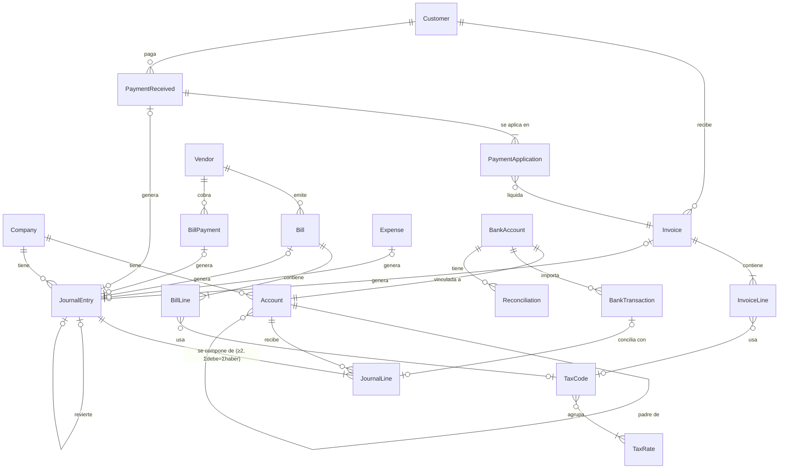

# Chirogra — Documento de diseño

> Estado: **borrador para revisión** (v0.1, 31 oct 2026).
> Nada de este documento está implementado todavía. Las secciones marcadas con 🔶 son decisiones abiertas que necesitan confirmación antes de escribir código.

---

## 1. Visión

**Chirogra** es una app de contabilidad para pequeños negocios (autónomos, comercios, despachos y empresas de servicios de 1 a 20 personas) que quieren llevar sus libros con rigor contable —doble partida real— sin necesitar formación de contador para el día a día.

Principios de producto:

1. **Rigor por debajo, sencillez por encima.** Cada factura, pago o gasto genera automáticamente su asiento de doble partida. El usuario trabaja con documentos de negocio; el libro diario se mantiene solo.
2. **Nada se borra, todo se corrige.** Un asiento contabilizado es inmutable. Las correcciones se hacen con asientos de reversión o anulaciones con rastro de auditoría.
3. **Nativa de Apple.** SwiftUI en iPhone, iPad y Mac, con atajos de teclado, arrastrar y soltar recibos, Face ID y modo oscuro desde el primer día.
4. **Datos del usuario, en dispositivos del usuario.** Funciona sin conexión; la sincronización en la nube es opcional y privada.
5. **Identidad propia.** Nombre, marca, diseño visual, iconografía y textos son originales de Chirogra. No se reutilizan la interfaz, los logos, la terminología de marca ni los flujos distintivos de ningún producto competidor (QuickBooks, Xero, Holded, etc.). Los términos contables genéricos (factura, asiento, balance) son de uso común y sí se usan.

---

## 2. Plataformas objetivo

| Plataforma | Rol | Navegación |
|---|---|---|
| **macOS** | Puesto principal de trabajo: captura masiva, conciliación, reportes | `NavigationSplitView` de 3 columnas, barra de herramientas, menús y atajos |
| **iPadOS** | Igual que Mac, con táctil y Pencil para notas en recibos | `NavigationSplitView` |
| **iOS (iPhone)** | Consulta rápida, facturar en movimiento, fotografiar recibos | `TabView` con 5 pestañas + pilas de navegación |

- **Un solo código SwiftUI multiplataforma** (un target de app multiplataforma en Xcode), con ajustes condicionales por tamaño de clase y plataforma.
- **Versión mínima propuesta:** iOS 26 / iPadOS 26 / macOS 26. 🔶
  - Motivo: SwiftData es notablemente más estable y completo a partir de la generación 26 (herencia de modelos, mejoras en predicados e historial). Con Xcode 27 se compila contra el SDK 27; soportar una versión hacia atrás cubre la gran mayoría de dispositivos activos.
  - Alternativa: iOS 18 / macOS 15 para más alcance, a cambio de evitar algunas APIs de SwiftData.
- **Fuera de alcance:** Android, web, Windows. Si en el futuro se necesitan, la capa de dominio (Swift puro, sin dependencias de Apple) es portable y la sincronización tendría que pasar a un backend propio (ver §6.5).

---

## 3. Alcance: MVP frente a fases posteriores

### 3.1 MVP (v1.0) — "libros completos de una empresa, en un dispositivo o en los dispositivos del mismo usuario"

| Módulo | Incluido en MVP |
|---|---|
| Alta de empresa | Asistente inicial: nombre, NIF/RFC/CIF, moneda, inicio del ejercicio fiscal, plantilla de plan de cuentas |
| Plan de cuentas | Árbol jerárquico, 5 tipos (Activo, Pasivo, Patrimonio, Ingreso, Gasto), códigos, activar/archivar, saldos |
| Asientos de diario | Asientos manuales multilínea, validación débito = crédito, borrador → contabilizado → revertido |
| Libro mayor | Movimientos por cuenta con saldo acumulado y filtro por fechas |
| Clientes y facturas de venta | Ficha de cliente, facturas con líneas, impuestos, numeración correlativa, cobros (totales y parciales), notas de crédito |
| Proveedores y facturas por pagar | Ficha de proveedor, facturas recibidas, pagos (totales y parciales) |
| Gastos / recibos | Gasto pagado al momento (efectivo, banco, tarjeta) con foto/PDF del recibo adjunto |
| Impuestos (IVA) | Tasas configurables, IVA repercutido / trasladado y soportado / acreditable en cuentas separadas, resumen del periodo |
| Reportes | Estado de resultados, balance general, balanza de comprobación, antigüedad de cuentas por cobrar y por pagar, resumen de IVA |
| Exportación | CSV de cualquier reporte/listado y PDF de facturas y reportes |
| Seguridad | Bloqueo con Face ID / Touch ID / contraseña del sistema, fecha de cierre (bloqueo de periodos) |
| Sincronización | iCloud privado (CloudKit) entre los dispositivos del **mismo** Apple ID — activable/desactivable 🔶 |

### 3.2 Fase 2

- **Conciliación bancaria** con importación de extractos CSV / OFX / CAMT.053, reglas de coincidencia y sesiones de conciliación.
- **Estado de flujo de efectivo** (método indirecto, con opción de método directo).
- Transacciones recurrentes (facturas y gastos periódicos).
- Lectura automática de recibos (Vision / OCR en el dispositivo) para prellenar gastos.
- Presupuestos y comparación real vs. presupuesto.
- Múltiples empresas en la misma app.
- Envío de facturas por correo con plantilla de marca propia del negocio.

### 3.3 Fase 3 y posteriores

- Conexión bancaria automática vía agregador (Plaid, GoCardless/Nordigen, Belvo…) — requiere backend.
- Multimoneda con revaluación cambiaria.
- Multiusuario con roles (dueño, contador, solo lectura) — ver §6.5.
- Facturación electrónica legal por país (CFDI 4.0 en México, Verifactu/TicketBAI en España, DTE en Chile, etc.).
- Inventario y costo de ventas, nómina, proyectos/centros de costo, cobro con tarjeta.

---

## 4. Módulos

### 4.1 Plan de cuentas (núcleo de doble partida)

- **Tipos fundamentales** y su saldo normal:

  | Tipo | Saldo normal | Aparece en |
  |---|---|---|
  | Activo | Deudor | Balance general |
  | Pasivo | Acreedor | Balance general |
  | Patrimonio | Acreedor | Balance general |
  | Ingreso | Acreedor | Estado de resultados |
  | Gasto | Deudor | Estado de resultados |

- **Subtipos** (determinan el comportamiento y la clasificación en reportes): efectivo, banco, cuentas por cobrar, inventario, activo fijo, otros activos corrientes; cuentas por pagar, tarjeta de crédito, impuestos por pagar, préstamos; capital, resultados acumulados; ventas, otros ingresos; costo de ventas, gastos operativos, otros gastos.
- **Jerarquía:** cuentas padre/hijo; los saldos se agregan hacia arriba. Solo las cuentas "hoja" admiten movimientos.
- **Cuentas de sistema** (no se pueden borrar ni cambiar de tipo): Cuentas por cobrar, Cuentas por pagar, IVA por pagar, IVA acreditable, Resultados acumulados, Resultado del ejercicio, Fondos no depositados.
- **Plantillas** de plan de cuentas según país/sector (genérica, servicios, comercio). 🔶 depende del país.
- Una cuenta con movimientos **no se borra**: se archiva.

### 4.2 Asientos de diario

- Un **asiento** (`JournalEntry`) tiene fecha, número correlativo, concepto, origen (manual, factura, pago, gasto, ajuste, cierre) y ≥ 2 **líneas** (`JournalLine`).
- Cada línea tiene cuenta, importe al **debe** o al **haber** (nunca ambos, nunca negativo), descripción opcional y, si aplica, cliente/proveedor y código de impuesto.
- **Invariantes** (validados en la capa de dominio y cubiertos por pruebas):
  1. Σ debe = Σ haber, en unidades mínimas de moneda (sin redondeos flotantes).
  2. Al menos dos líneas y al menos una cuenta distinta en cada lado.
  3. Importes > 0.
  4. Solo cuentas hoja y activas.
  5. Fecha posterior a la fecha de cierre del periodo.
- **Estados:** `borrador` (editable, no afecta saldos) → `contabilizado` (inmutable, afecta saldos) → `revertido` (se genera un asiento espejo con fecha elegida; el original queda vinculado).
- Los asientos generados por documentos (factura, pago…) **solo** se modifican modificando o anulando el documento.

### 4.3 Clientes y facturas de venta (cuentas por cobrar)

- **Cliente:** nombre/razón social, identificación fiscal, correo, teléfono, dirección de facturación, condiciones de pago (contado, 15/30/60 días), tasa de impuesto por defecto, notas.
- **Factura:** cliente, número (serie + correlativo sin huecos), fecha, vencimiento, líneas (descripción, cantidad, precio unitario, descuento, cuenta de ingreso, código de impuesto), subtotal, impuestos, total, saldo pendiente, notas, adjuntos.
- **Estados:** borrador → emitida → parcialmente cobrada → cobrada; o anulada. "Vencida" es un estado derivado (fecha > vencimiento y saldo > 0).
- **Cobro:** fecha, cliente, cuenta de destino (banco/caja o *Fondos no depositados*), importe, método, aplicación a una o varias facturas.
- **Nota de crédito:** documento negativo vinculado a una factura; genera el asiento inverso.
- **Asientos automáticos:**

  | Evento | Debe | Haber |
  |---|---|---|
  | Emitir factura | Cuentas por cobrar (total) | Ingresos (subtotal por línea) · IVA por pagar (impuesto) |
  | Cobro | Banco / Caja | Cuentas por cobrar |
  | Nota de crédito | Ingresos · IVA por pagar | Cuentas por cobrar |
  | Anular factura | Asiento de reversión del original | |

### 4.4 Proveedores y facturas por pagar (cuentas por pagar)

- **Proveedor:** espejo del cliente (datos fiscales, condiciones de pago, cuenta de gasto por defecto).
- **Factura de proveedor:** proveedor, número del proveedor, fecha, vencimiento, líneas (cuenta de gasto/activo, importe, código de impuesto), adjunto.
- **Pago:** cuenta de origen, importe, aplicación a una o varias facturas.

  | Evento | Debe | Haber |
  |---|---|---|
  | Registrar factura | Gasto/Activo (subtotal) · IVA acreditable | Cuentas por pagar (total) |
  | Pago | Cuentas por pagar | Banco / Caja / Tarjeta |

### 4.5 Gastos y recibos

- Gasto **pagado al momento** (no pasa por cuentas por pagar): beneficiario (proveedor opcional), fecha, cuenta de pago (caja, banco, tarjeta), líneas de gasto con impuesto, recibo adjunto (foto, PDF, imagen arrastrada).
- Asiento: **Debe** Gasto(s) + IVA acreditable / **Haber** cuenta de pago.
- Los adjuntos se guardan como archivos externos al almacén (`.externalStorage`) y se comprimen las fotos.
- Fase 2: OCR en el dispositivo (Vision) para proponer proveedor, fecha, total e impuesto.

### 4.6 Conciliación bancaria (fase 2, el modelo se prepara desde el MVP)

- **Cuenta bancaria:** vinculada 1:1 a una cuenta contable de subtipo banco o tarjeta.
- **Importación de extracto** (CSV con mapeo de columnas guardado, OFX, CAMT.053) → `BankTransaction` (fecha, descripción, importe con signo, identificador único del banco para evitar duplicados).
- **Coincidencia:** para cada movimiento bancario se proponen líneas del diario no conciliadas de esa cuenta con mismo importe y fecha cercana (±5 días). El usuario confirma, o crea un gasto/cobro/transferencia desde el propio movimiento.
- **Reglas** ("si la descripción contiene X, categorizar en cuenta Y").
- **Sesión de conciliación:** fecha y saldo final del extracto; la diferencia (saldo según libros − saldo según banco) debe llegar a 0 para cerrarla. Las líneas conciliadas quedan marcadas y no deben editarse sin advertencia.

### 4.7 Reportes

Todos los reportes se calculan **a partir de las líneas contabilizadas** (fuente única de verdad), por rango de fechas y con comparativo opcional (periodo anterior / mismo periodo del año anterior). Exportables a PDF y CSV.

| Reporte | Cálculo |
|---|---|
| **Estado de resultados** | Σ Ingresos − Σ Costo de ventas = Utilidad bruta; − Gastos operativos ± Otros = Utilidad neta, en el rango |
| **Balance general** | Saldos a una fecha: Activo = Pasivo + Patrimonio, con el resultado del ejercicio en curso calculado al vuelo |
| **Balanza de comprobación** | Saldo deudor/acreedor de cada cuenta a una fecha; sus totales deben coincidir (comprobación de integridad) |
| **Flujo de efectivo** (fase 2) | Método indirecto: utilidad neta + partidas no monetarias ± variación de capital de trabajo; inversión; financiamiento |
| **Antigüedad de CxC / CxP** | Saldo pendiente por cliente/proveedor en tramos: corriente, 1–30, 31–60, 61–90, > 90 días vencido |
| **Resumen de IVA** | IVA repercutido − IVA soportado del periodo, por tasa, con detalle de documentos |
| **Libro diario / mayor** | Listados de asientos y movimientos por cuenta |

### 4.8 Impuestos / IVA

- **Tasa de impuesto** (`TaxRate`): nombre, porcentaje, cuenta de impuesto repercutido (ventas) y cuenta de impuesto soportado (compras), vigencia.
- **Código de impuesto** (`TaxCode`): combinación de una o varias tasas aplicada a una línea (p. ej. "IVA 16 %", "Exento", "IVA 21 % + Recargo de equivalencia 5,2 %", "Retención ISR 10 %"). Las retenciones se modelan como tasas negativas con su propia cuenta.
- **Precios con o sin impuesto incluido**, por documento.
- **Redondeo:** por línea o por total del documento (configurable; algunos países exigen uno u otro).
- **Liquidación del periodo:** asiento que traslada IVA repercutido e IVA soportado a "IVA a pagar/compensar".
- 🔶 **País y moneda iniciales** determinan las tasas por defecto, el plan de cuentas plantilla, el formato del identificador fiscal y la terminología (IVA trasladado/acreditable en México vs. repercutido/soportado en España).

---

## 5. Modelo de datos

### 5.1 Decisiones transversales

- **Dinero:** se guarda como **`Int64` en unidades mínimas** (centavos) más el código ISO 4217 de la moneda. En el dominio se usa un tipo `Money` (valor + moneda) con aritmética exacta; `Decimal` solo para mostrar y para porcentajes. Nunca `Double`.
- **Identificadores:** `UUID` propio en cada entidad (`id`), además del identificador persistente de SwiftData, para referencias estables, exportación e importación.
- **Fechas contables:** se guarda la **fecha de negocio** (día sin hora, normalizada a la zona horaria de la empresa) separada del instante de creación/modificación (`createdAt`, `updatedAt`).
- **Compatibilidad con CloudKit desde el día 1:** todas las relaciones opcionales, todas las propiedades con valor por defecto, sin `@Attribute(.unique)` (la unicidad, p. ej. de números de factura, se valida en la capa de dominio).
- **Borrado:** lógico (`isArchived`) para entidades maestras; los documentos contabilizados no se borran, se anulan.
- **Auditoría:** `AuditEvent` registra quién (dispositivo/usuario), cuándo, qué entidad y qué acción.

### 5.2 Entidades

| Entidad | Campos principales | Relaciones |
|---|---|---|
| `Company` | nombre, razón social, idFiscal, país, monedaBase, inicioEjercicio (mes), fechaCierre, zonaHoraria, logo | 1→N todo lo demás |
| `Account` | código, nombre, tipo, subtipo, saldoNormal (derivado del tipo), esSistema, isArchived, descripción | padre 0..1, hijos N, líneas N, bankAccount 0..1 |
| `JournalEntry` | número, fecha, concepto, estado, origen, referencia | líneas N (cascade), documentoOrigen 0..1, revierteA 0..1, revertidoPor 0..1 |
| `JournalLine` | debeMinor, haberMinor, descripción, orden | asiento 1, cuenta 1, cliente 0..1, proveedor 0..1, taxCode 0..1, bankTransaction 0..1 |
| `Customer` | nombre, idFiscal, email, teléfono, dirección, condicionesPago, notas, isArchived | facturas N, cobros N, taxCode por defecto 0..1 |
| `Vendor` | ídem cliente + cuenta de gasto por defecto | facturas N, pagos N, gastos N |
| `Invoice` | serie, número, fecha, vencimiento, estado, preciosConImpuesto, notas | cliente 1, líneas N (cascade), aplicacionesDeCobro N, asiento 0..1, adjuntos N |
| `InvoiceLine` | descripción, cantidad, precioUnitarioMinor, descuento, orden | factura 1, cuentaIngreso 1, taxCode 0..1, producto 0..1 |
| `CreditNote` | número, fecha, motivo | factura 0..1, cliente 1, líneas N, asiento 0..1 |
| `PaymentReceived` | fecha, importeMinor, método, referencia | cliente 1, cuentaDestino 1, aplicaciones N, asiento 0..1 |
| `PaymentApplication` | importeMinor | cobro/pago 1, factura/facturaProveedor 1 |
| `Bill` | númeroProveedor, fecha, vencimiento, estado | proveedor 1, líneas N, aplicacionesDePago N, asiento 0..1, adjuntos N |
| `BillLine` | descripción, importeMinor, orden | bill 1, cuenta 1, taxCode 0..1 |
| `BillPayment` | fecha, importeMinor, método, referencia | proveedor 1, cuentaOrigen 1, aplicaciones N, asiento 0..1 |
| `Expense` | fecha, beneficiario, método, referencia | proveedor 0..1, cuentaPago 1, líneas N, asiento 0..1, adjuntos N |
| `Item` (producto/servicio) | nombre, descripción, precioMinor, isArchived | cuentaIngreso, cuentaGasto, taxCode por defecto |
| `TaxRate` | nombre, porcentaje (Decimal), vigenteDesde/Hasta, esRetención | cuentaRepercutido, cuentaSoportado |
| `TaxCode` | nombre, isArchived | tasas N |
| `BankAccount` | nombre, banco, últimos4, mapeoCSV | cuenta contable 1, transacciones N, conciliaciones N |
| `BankTransaction` | fecha, descripción, importeMinor (con signo), idExterno, estado | bankAccount 1, línea conciliada 0..1, importación 1 |
| `Reconciliation` | fechaExtracto, saldoExtractoMinor, estado | bankAccount 1, líneas conciliadas N |
| `Attachment` | nombreArchivo, tipoUTI, datos (externalStorage), miniatura | documento dueño |
| `NumberSequence` | tipoDocumento, serie, siguienteNúmero, formato | company |
| `AuditEvent` | fecha, actor, entidad, idEntidad, acción, resumen | company |

### 5.3 Diagrama de relaciones (núcleo)



### 5.4 Saldos

Los saldos **no se almacenan**: se calculan sumando líneas contabilizadas. Para rendimiento, en fase 2 se puede añadir una caché de saldos por cuenta y mes (`AccountPeriodBalance`) que se recalcula al contabilizar, con verificación contra la suma real en las pruebas.

---

## 6. Arquitectura

### 6.1 Persistencia: SwiftData (recomendado)

| Opción | A favor | En contra | Veredicto |
|---|---|---|---|
| **SwiftData** | Nativo, integración directa con SwiftUI (`@Query`), sincronización CloudKit privada casi gratuita, macros `@Model` concisas | Rendimiento con decenas de miles de líneas por verificar, predicados limitados, sin compartir CloudKit entre usuarios | ✅ **Elegida para el MVP** |
| Core Data + `NSPersistentCloudKitContainer` | Maduro, soporta compartir (CKShare) entre Apple IDs, más control | Más código, menos ergonómico con Swift 6 concurrency | Plan B si se necesita multiusuario sin backend |
| SQLite (GRDB) | SQL real (agregados rápidos para reportes), control total, portable | Sincronización a mano, más código de UI | Plan B si SwiftData no rinde en reportes |
| Backend propio (Postgres + API) | Multiusuario, web, Android, conexiones bancarias | Infraestructura, costos, seguridad, cuentas de usuario | Fase 3 si el producto lo exige |

**Mitigación del riesgo de SwiftData:** el dominio no depende de SwiftData. Los reportes y validaciones trabajan con *structs* de valor (`LedgerLine`, `Money`) producidos por un repositorio; cambiar la persistencia sólo afecta a la capa de datos.

### 6.2 Capas y estructura del código

```
Chirogra/
├── Chirogra.xcodeproj              # App multiplataforma (iOS + iPadOS + macOS), target fino
├── App/                            # @main, escenas, inyección del ModelContainer, assets, Info.plist
├── Packages/ChirograKit/           # Swift Package local con toda la lógica
│   ├── Package.swift
│   ├── Sources/
│   │   ├── ChirograCore/           # Dominio puro: Money, AccountType, reglas de doble partida,
│   │   │                           # validación de asientos, motores de contabilización (factura→asiento),
│   │   │                           # cálculo de impuestos y reportes. Sin SwiftUI ni SwiftData.
│   │   ├── ChirograData/           # Modelos @Model, esquema versionado + migraciones,
│   │   │                           # repositorios, plantillas de plan de cuentas, datos de ejemplo
│   │   └── ChirograUI/             # Vistas SwiftUI por módulo, componentes de diseño, view models
│   └── Tests/
│       ├── ChirograCoreTests/      # Swift Testing: invariantes, impuestos, reportes
│       └── ChirograDataTests/      # Contenedor en memoria: contabilización end-to-end
└── docs/
```

- **ChirograCore** — lógica pura y determinista; aquí viven las reglas que no pueden fallar (débito = crédito, cálculo de impuestos, reportes). Se prueba con `swift test` sin simulador.
- **ChirograData** — traduce entre `@Model` y tipos de dominio; `PostingService` convierte documentos en asientos dentro de una sola transacción de `ModelContext`.
- **ChirograUI** — SwiftUI con el patrón *Observation* (`@Observable`) para estado de pantalla y `@Query` para listas; sin lógica contable en las vistas.
- **Concurrencia:** Swift 6 en modo estricto. Los cálculos pesados de reportes se ejecutan en un `@ModelActor` en segundo plano y devuelven *structs* `Sendable`.

### 6.3 Flujo de contabilización

```
Usuario guarda factura ─► ChirograUI (InvoiceEditor)
                          └─► PostingService.post(invoice)          [ChirograData]
                                ├─ mapea a InvoiceDraft (struct)
                                ├─ InvoicePostingRule.entry(for:)    [ChirograCore] → JournalEntryDraft
                                ├─ JournalValidator.validate(draft)  [ChirograCore] → Σdebe == Σhaber, etc.
                                ├─ asigna número (NumberSequence)
                                └─ inserta JournalEntry + líneas + AuditEvent y guarda (todo o nada)
```

### 6.4 Esquema y migraciones

- `VersionedSchema` desde la v1 y `SchemaMigrationPlan`, aunque al principio solo haya una versión: evita dolores al primer cambio con usuarios reales.
- Copia de seguridad exportable/importable (archivo `.chirogra` = JSON comprimido + adjuntos) independiente de iCloud.

### 6.5 Sincronización con iCloud / CloudKit (opcional)

- **MVP:** `ModelConfiguration(cloudKitDatabase: .private(...))` → los datos viajan cifrados entre los dispositivos del **mismo** Apple ID. Interruptor en Ajustes; desactivado = 100 % local.
- **Reglas de modelo** ya aplicadas (§5.1): relaciones opcionales, valores por defecto, sin `.unique`.
- **Conflictos contables:** CloudKit resuelve "el último gana" por registro. Para no romper la contabilidad:
  - Los asientos contabilizados son inmutables → no hay conflictos de edición sobre ellos.
  - **Numeración correlativa**: dos dispositivos sin conexión podrían emitir el mismo número. Mitigación MVP: el número definitivo se asigna al contabilizar y se valida al sincronizar; si hay colisión se renumera el borrador más reciente y se avisa. Alternativa: series por dispositivo (A-0001 en Mac, B-0001 en iPhone). 🔶
  - Verificación de integridad tras cada sincronización (balanza cuadrada, sin asientos descuadrados).
- **Multiusuario (varias personas/Apple IDs):** SwiftData no permite compartir zonas de CloudKit entre usuarios. Opciones futuras: Core Data con `CKShare`, o backend propio. 🔶

### 6.6 Seguridad y privacidad

- Bloqueo de app con `LocalAuthentication`; protección de datos de archivos `complete` en iOS.
- Sin analítica de terceros; si se añade telemetría, anónima y opcional.
- Fecha de cierre de periodo (nadie contabiliza antes de ella sin desbloquear explícitamente).

---

## 7. Diseño visual e identidad (original de Chirogra)

- **Concepto:** "el cuaderno de cuentas, ordenado". Superficies limpias, mucha tipografía y números legibles.
- **Paleta propuesta:** tinta azul petróleo profundo (`#0F4C5C`) como color principal, acento ámbar cálido (`#E9A23B`) para acciones, verde salvia para saldos a favor y terracota para vencidos/negativos; neutros cálidos de papel. Se evita deliberadamente el verde característico de otras apps contables. 🔶
- **Tipografía:** SF Pro con cifras tabulares (`.monospacedDigit()`) en todas las columnas de importes; SF Pro Rounded solo para cifras grandes del panel.
- **Iconografía:** SF Symbols + un monograma propio "C" con forma de pluma/renglón para el ícono de app (a diseñar).
- **Tono de los textos:** cercano y claro, de tú, sin jerga innecesaria; la jerga contable aparece donde aporta precisión ("asiento", "saldo"), siempre con ayuda contextual.
- **Accesibilidad:** Dynamic Type, VoiceOver con importes leídos como moneda, contraste AA, no depender solo del color para positivo/negativo.

---

## 8. Pantallas principales y navegación

### 8.1 Estructura

| Sección (Mac/iPad: barra lateral) | iPhone (pestaña) | Contenido |
|---|---|---|
| **Inicio** | Inicio | Panel: efectivo disponible, por cobrar, por pagar, resultado del mes, facturas vencidas, acciones rápidas |
| **Ventas** | Ventas | Facturas · Cobros · Clientes · Notas de crédito |
| **Compras** | Compras | Facturas por pagar · Pagos · Gastos · Proveedores |
| **Banco** *(fase 2)* | (dentro de Contabilidad) | Cuentas bancarias · Importar extracto · Conciliar |
| **Contabilidad** | Libros | Plan de cuentas · Asientos · Libro mayor · Impuestos |
| **Reportes** | Reportes | Catálogo de reportes con filtros de periodo |
| **Ajustes** | (desde Inicio, menú de perfil) | Empresa · Impuestos · Numeración · Seguridad · iCloud · Exportar/Copia de seguridad |

### 8.2 Pantallas del MVP

1. **Bienvenida y alta de empresa** (asistente de 4 pasos: datos fiscales → moneda y ejercicio → plantilla de cuentas → impuestos).
2. **Panel de inicio** con tarjetas de indicadores y lista de "pendiente hoy".
3. **Plan de cuentas:** árbol con saldos; detalle de cuenta = libro mayor de esa cuenta.
4. **Editor de asiento:** tabla de líneas con totales de debe/haber en vivo y diferencia resaltada hasta cuadrar; botón "Contabilizar" deshabilitado mientras no cuadre.
5. **Lista de asientos** con búsqueda y filtros por origen, estado y fecha.
6. **Clientes:** lista + ficha con saldo, facturas y cobros.
7. **Editor de factura:** cabecera, líneas, impuestos calculados, vista previa PDF, emitir.
8. **Registrar cobro:** seleccionar cliente → facturas abiertas → repartir importe.
9. **Proveedores / Facturas por pagar / Registrar pago:** simétricos a ventas.
10. **Nuevo gasto:** cámara o arrastrar recibo, cuenta de pago, líneas de gasto.
11. **Reportes:** visor con selector de periodo, comparativo, profundizar (tocar un importe abre los movimientos que lo componen), exportar.
12. **Ajustes.**

### 8.3 Acciones rápidas y teclado (Mac)

- Botón global "Nuevo…" (factura, gasto, cobro, asiento) y atajos: ⌘N factura, ⇧⌘E gasto, ⇧⌘J asiento, ⌘F buscar.
- Búsqueda global por número, cliente, importe o concepto.

---

## 9. Estrategia de pruebas

- **ChirograCore (Swift Testing):**
  - Asiento válido cuadra; asiento descuadrado, con una sola línea, con importes negativos o con debe y haber en la misma línea → rechazado con error específico.
  - Cada regla de contabilización (factura, cobro, factura de proveedor, pago, gasto, nota de crédito, reversión) produce asientos cuadrados y con las cuentas correctas.
  - Pruebas tipo propiedad: miles de documentos aleatorios → la balanza de comprobación siempre cuadra y Activo = Pasivo + Patrimonio.
  - Impuestos: redondeo por línea vs. por documento, precios con impuesto incluido, retenciones.
  - Reportes con datos de ejemplo de resultado conocido.
- **ChirograData:** contenedor en memoria; contabilización end-to-end y atomicidad (si la validación falla no queda nada guardado).
- **UI:** pruebas de humo con XCUITest en fase 2.
- **CI:** GitHub Actions con `swift test` del paquete y `xcodebuild build` de ambos destinos. 🔶

---

## 10. Riesgos y decisiones abiertas

### 10.1 Riesgos

| Riesgo | Impacto | Mitigación |
|---|---|---|
| Rendimiento de SwiftData en reportes con muchos datos | Medio | Dominio desacoplado; caché de saldos por periodo; plan B GRDB |
| Conflictos de sincronización (numeración, ediciones simultáneas) | Alto | Inmutabilidad de asientos, numeración al contabilizar con validación, verificación de integridad |
| Requisitos legales por país (facturación electrónica, conservación, formatos) | Alto | Elegir un país inicial; MVP como contabilidad de gestión y declarar que la factura legal electrónica llega en fase 3 |
| Pérdida de datos del usuario | Alto | Copias de seguridad exportables, iCloud opcional, migraciones versionadas probadas |
| Parecido con productos competidores (marca/interfaz) | Medio | Identidad original (§7), revisión de diseño antes de publicar, búsqueda de marca "Chirogra" en registros (USPTO/EUIPO/IMPI) |
| Errores contables silenciosos | Alto | Invariantes en el dominio, pruebas de propiedad, balanza visible en la app |

### 10.2 Decisiones abiertas 🔶 (para confirmar con el usuario)

1. **Plataformas y versión mínima:** ¿iOS + iPadOS + macOS con mínimo 26? ¿O solo una de ellas primero?
2. **País y moneda iniciales:** determina tasas de IVA, retenciones, plan de cuentas plantilla y terminología (México, España, Colombia, Argentina, Chile, EE. UU.…).
3. **Usuarios:** ¿una persona (dueño) o varias personas con acceso (p. ej. dueño + contador)? Cambia la elección de persistencia.
4. **Sincronización:** ¿iCloud entre mis dispositivos en el MVP, o empezar 100 % local?
5. **Alcance del MVP:** ¿la conciliación bancaria y el flujo de efectivo pueden esperar a la fase 2?
6. **Numeración con varios dispositivos:** ¿serie única validada o series por dispositivo?
7. **Identidad visual:** ¿te sirve la paleta azul petróleo + ámbar como punto de partida?
8. **Idiomas:** ¿solo español, o español + inglés desde el inicio (String Catalogs)?

---

## 11. Plan de la fase 2 de este proyecto (tras aprobar el diseño)

1. Crear el Swift Package `ChirograKit` (Core, Data, UI) y el proyecto Xcode multiplataforma que lo usa.
2. Implementar en `ChirograCore`: `Money`, `AccountType`, `JournalEntryDraft`, `JournalValidator` y las reglas de contabilización de factura, cobro, factura de proveedor, pago y gasto.
3. Pruebas unitarias que verifican débito = crédito y el resto de invariantes.
4. Modelos SwiftData del MVP con esquema versionado y plantilla de plan de cuentas.
5. Pantallas base: navegación, plan de cuentas, lista/editor de asientos, clientes, facturas, proveedores, gastos y un reporte (balanza de comprobación).
6. `swift test` y `xcodebuild` en verde para iOS y macOS; commits en `main`.
